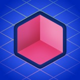

# 六类视觉方向：看图沟通用

用于前期选型，不是行业配方、互斥分类或风格优劣榜。文字是主体类型，扁平/拟物是画法，渐变是色彩手法；六个入口以主导视觉特征组织，允许合理交叠。需要其他方向时也可补充，不以六类限制用户意图。

## 先展示什么

离线图集：`../assets/style-gallery.html`，含六张主卡与一张场景补充。直接聊天展示时，把下面相对路径解析到当前技能目录，再用绝对路径嵌入图片。

先展示参考图，说明可借鉴的结构或画法，推荐最适合本产品的一至两类，并明确用户可以选择 1–3 种，分别呈现同一品牌主张。不要默认替用户全选，不先生成六张自己的Logo来当风格参考。用户授权生成后，未另定数量时每种所选风格先做一张。

## 样本口径

- 获奖信息来自 Apple Design Awards 官方页面；**获奖的是App/游戏设计体验，并非其图标单独获奖**。
- 下列图像是 **2026-11-07 美国 App Store 接口返回的当前图标快照**，不证明获奖年份使用了同一图标。它们可能包含当时系统或商店添加的光影/外观效果。
- 本地160px小图仅供来源明确的设计研究与选型观察；品牌和图像权利归相应权利人。不要当成用户资产、成品模板或拟仿对象。
- 六类不是由一届获奖名单统计出的官方结论；本图集选用2017、2018、2024跨年份样本，未宣称穷尽历届产品或覆盖最新一年所有获奖者。

## S1 拟物材质

**观察样本**：Crouton，2024 Interaction 获奖。

**看得见的特征**：米白收纳盒、叠放卡片、材质纹理与边缘受光；熟悉器物让用户能想象它如何被使用。

**适合讨论的诉求**：希望有熟悉感、日常触感，或某件实物与品牌体验有直接联系。

**风险与减法**：质感不能代替独有轮廓；缩小时保留物件与关系，减少纹理和细光影。

**提示词模块**：`one familiar tactile object, clear material and silhouette, restrained depth, controlled highlights, recognizable at app-icon size`。物件和颜色由本产品决定。

来源：[获奖页](https://developer.apple.com/design/awards/2024/#interaction)、[App Store](https://apps.apple.com/us/app/id1461650987)。

## S2 扁平极简

**观察样本**：Blackbox，2017 获奖。

**看得见的特征**：青色圆角方框与中心圆点构成主识别，形状少、轮廓直接。当前快照有背景字符和边缘光，不应把整张现行图标描述为“绝无纹理的纯扁平”。

**适合讨论的诉求**：强调直接识别、稳定形状、少信息和小尺寸表现。具体物件、字形、抽象图案都可用这套画法。

**风险与减法**：线框太细、意义太空、图形过于通用。使用粗细由实际尺寸决定，不把“越细越高级”当原则。

**提示词模块**：`simple bold silhouette, clean flat color fields, deliberate negative space, consistent visual weight, optical balance`。

来源：[2017获奖公告](https://www.apple.com/uk/newsroom/2017/06/apple-design-awards-celebrate-the-best-in-innovation-and-creativity/)、[App Store](https://apps.apple.com/us/app/id962969578)。

## S3 文字字标

**观察样本**：NYT Games，2024 Delight and Fun 获奖。

**看得见的特征**：具有既有品牌身份的白色T字形与彩色格子形成主次。借鉴的是字形识别与构图关系，不能照抄T或其品牌字形。

**适合讨论的诉求**：名称本身有辨识度、需要强化记名，或已有字母/汉字资产可沿用。

**风险与减法**：塞进完整长名称导致缩小难读；定制到丢失原字；仅换字体而没有品牌特征。是否一个字、首字母或短词由名称决定。

**提示词模块**：`custom legible letterform, strong optical spacing, distinctive stroke structure, compact typographic silhouette`；另行精确声明要渲染的文字。

来源：[获奖页](https://developer.apple.com/design/awards/2024/#delight-and-fun)、[App Store](https://apps.apple.com/us/app/id307569751)。

## S4 渐变光感

**观察样本**：Procreate Dreams，2024 Innovation 获奖。

**看得见的特征**：深底上由暖到冷的渐变斜带，色彩流动与清楚的重复形状共同识别。

**适合讨论的诉求**：希望色彩本身成为记忆线索，表达创作、流动、感知或能量；是否用于工具、生活或娱乐由品牌主张决定。

**风险与减法**：有渐变没有图形身份；过多光效缩小后糊成一团；套进常见紫蓝AI光球。

**提示词模块**：`a recognizable silhouette carrying one controlled luminous color transition, restrained highlight, clear foreground-background separation`。

来源：[获奖页](https://developer.apple.com/design/awards/2024/#innovation)、[App Store](https://apps.apple.com/us/app/id1595520602)。

## S5 立体空间

**观察样本**：Rooms，2024 Visuals and Graphics 获奖。

**看得见的特征**：等距的粉色开放体块、不同朝向平面、蓝色网格；透视与面之间的明暗建立空间。

**适合讨论的诉求**：物体需要体积、搭建、层叠、可触摸的构造，或品牌希望有鲜明的空间物件。

**风险与减法**：做成满是物件的微缩景观，靠高光堆品质，轮廓在复杂背景中消失。C4D/Blender是制作工具，不是风格必要条件。

**提示词模块**：`one compact dimensional object, coherent perspective, broad readable planes, restrained material response, a single clear lighting direction`。

来源：[获奖页](https://developer.apple.com/design/awards/2024/#visuals-and-graphics)、[App Store](https://apps.apple.com/us/app/id6443548715)。

## S6 插画叙事

**角色样本**：Bears Gratitude，2024 Delight and Fun 获奖。

**看得见的特征**：熊与被抱住的心、另一小角色构成可读的情绪关系；人物、动作和表情是主识别。

**场景补充**：Alto's Odyssey，2018 获奖。当前图标用建筑剪影、天际、气球与前后景组成一个可想象的世界；不能把这张当前版认定为2018当年版本。

**适合讨论的诉求**：用户希望看见一个角色、一种生活状态或一个令人向往的具体时刻。支持单个角色，也支持有主角与动作的场景，不自动压成吉祥物头像。

**风险与减法**：场景像旅游、阅读、冥想或游戏；缩小时主体动作消失。优先保留用户指定关系，减少衣褶、发丝、细浪、背景小物。

**提示词模块**：`a clearly recognizable subject in one specific action or life moment, readable pose and relationships, simplified supporting environment, mature illustration, one dominant focal point`。

来源：[Bears获奖页](https://developer.apple.com/design/awards/2024/#delight-and-fun)、[Bears App Store](https://apps.apple.com/us/app/id6443609622)、[Alto2018获奖公告](https://www.apple.com/ca/newsroom/2018/06/apple-design-awards-highlight-excellence-in-app-and-game-design/)、[Alto App Store](https://apps.apple.com/us/app/id1182456409)。

## 选型规则

1. 产品判断已确认后，再用这些实际图像讨论画法。不给“所有金融App都用扁平几何”的固定答案。
2. 默认按同一品牌主张探索所选的 1–3 种风格，具体内容可分别构思；不把第一张图的物件、构图自动固定给其余方向。若用户明确要求同一内容比较画法，才保留主体、动作与关系，并说明这是画法对照。
3. 明确用户最喜欢参考里的什么：材质、轮廓、动作、配色关系还是空间。只带走这一层，不复制品牌身份。
4. 拟物强调借现实物件与材质建立熟悉感；新拟物强调近似同色表面的凸凹；玻璃态强调半透明、折射/模糊；3D强调空间与体积。它们可组合，但不视作同义词，也不因某硬件发布就宣称所有图标正在回潮。
5. 不用错误或过时的图标名称佐证风格。如“知乎=Z”“美团=M”需先核验实际版本，不直接写入参考库。

## 图像来源与维护

官方图像元数据查询：

https://itunes.apple.com/lookup?id=1461650987,962969578,307569751,1595520602,6443548715,6443609622,1182456409&country=us

`artworkUrl512`为本次下载来源；本地缩至160px只供观察。重新研究“当前图标”时刷新元数据并实际看图，不凭旧快照描述现状。新增案例需分别核验获奖事实与图标外观；找不到来源时标待核验，不填造图。
